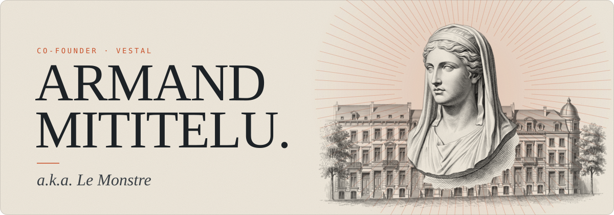
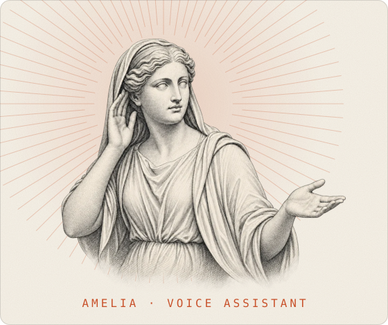

  

<picture>
  <source media="(prefers-color-scheme: dark)" srcset="./assets/divider-vestal-dark.svg" />
  
</picture>

**Co-founder of [Vestal](https://vestalai.be).** Real estate agencies deserve the best Agent-as-a-Service money can buy. We build it.

Meet **Amelia**, our voice assistant. She answers every call, in French, Dutch and English, day and night, straight into their CRM.
Every missed call is a missed mandate. **We don't miss calls.**

*A vestal kept the fire burning. Amelia keeps the line open.*

Running a real estate agency in Belgium? Try calling one of ours. If Amelia misses, coffee's on me.
📩 **armand@vestalai.be** · [LinkedIn](https://www.linkedin.com/in/armand-mititelu-244467332/)

<picture>
  <source media="(prefers-color-scheme: dark)" srcset="./assets/divider-off-the-clock-dark.svg" />
  
</picture>

- 🏋️ **Bench press: 130 kg.** Models get lighter every quarter. The bar doesn't.
- 🎧 **K-pop:** MEOVV, izna, NMIXX. All three. No, I won't rank them.
- 🎓 **[42 Brussels](https://www.42network.org/) alumnus.** They taught me C with no teachers and no mercy. Now I debug a model that talks back.

> *"Rapidity is the essence of war."*
> — Sun Tzu, *The Art of War*
